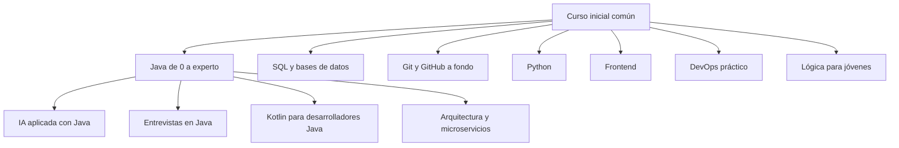
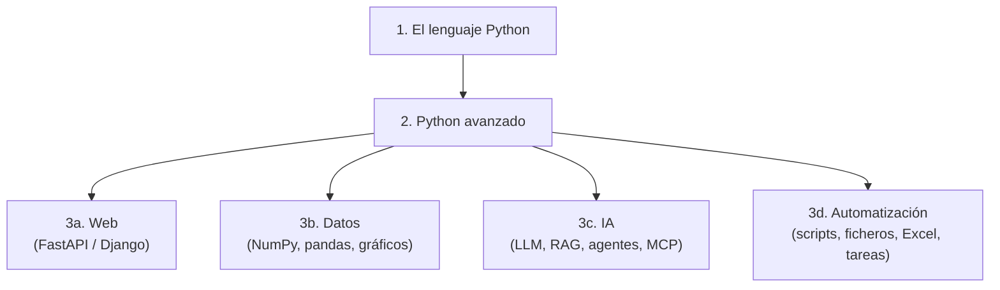
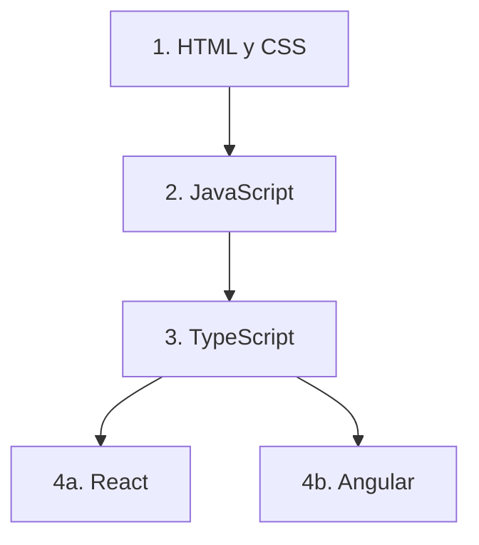

# Plan del Proyecto Academia

> Plan general, 8 de noviembre de 2026. Sale de la propuesta de nuevos cursos escrita al terminar el curso de Java (`PROPUESTA-NUEVOS-CURSOS.md` del curso original) y de lo decidido con el autor en la sesión de planificación de ese día.
> Dónde estamos y qué toca ahora: [`ESTADO.md`](ESTADO.md). Estructura y normas de la carpeta: [`README.md`](README.md).

## 1. Objetivo

Montar una academia online de programación con muchos cursos que:

- **no repiten** lo básico: todo lo común está en un **curso inicial** que hace cualquier alumno;
- comparten **la misma estructura, los mismos nombres y el mismo formato**, para que la academia los importe todos igual y el alumno encuentre siempre las cosas en el mismo sitio;
- se escriben con **el mismo método** que el curso de Java original (plan, plantilla, verificación de todo el código, un commit por módulo, revisión del autor por fase), recogido en un **kit de herramientas**.

El curso de Java original y Code Academy fueron el aprendizaje; este proyecto es lo de verdad y **aprovecha todo** lo que se construyó en ellos.

## 2. Decisiones tomadas (8 de noviembre de 2026)

1. **Estructura**: `Proyecto Academia/` agrupa `Academia/` y `Cursos/`; dentro de `Cursos/` van `kit-cursos/` y un proyecto por curso. Cada proyecto, su repositorio. La raíz es un repositorio pequeño con la planificación común. Rutas relativas siempre, para poder copiar la carpeta entera (ver `README.md`).
2. **Kit de herramientas** (`Cursos/kit-cursos/`): interno, el alumno no lo ve. Los cursos lo usan desde `../kit-cursos/`, sin copiarlo. Se hace **lo justo** para el curso inicial y se mejora cuando lo pida el siguiente curso.
3. **Curso inicial común** (`Cursos/curso-inicial/`, nombre público por decidir): lo único común a todos los cursos. Después, cada curso se puede hacer por separado.
4. **Curso de Java nuevo** (`Cursos/curso-java/`, **opción A**): copia del curso de Java original **con su historial**, adaptada para empezar donde acaba el curso inicial y con la misma estructura que el resto de cursos. Cuando esté hecho no referencia ni necesita el original. Que es la segunda edición se dice en su `README.md` y su historial, no en el nombre.
5. **Academia** (`Academia/`): copia de Code Academy **con su historial**, adaptada a varios cursos. Empieza **sin alumnos**, así que cada curso entra en ella desde cero (sin conflictos de progreso con la primera edición del curso de Java).
6. **Los proyectos de origen se quedan como archivo**: `Curso Java Completo` y `Code Academy` no se modifican.
7. **Cursos grandes publicados por partes** en la academia, pero escritos y mantenidos como un solo curso (apartado 4).
8. **Frontend con React y Angular** como caminos alternativos: primero React, Angular después.
9. **La marca «Code Academy» se cambia antes de publicar**: se parece demasiado a Codecademy (conflicto de marca y visibilidad). El nombre se elige más adelante; la carpeta se llama `Academia/` para que el nombre no afecte a ninguna ruta.
10. **Normas de trabajo**: un curso publicado en la academia antes de empezar el siguiente; el kit, lo justo; todo lo importante, escrito.

## 3. El catálogo de cursos

### 3.1. Qué pide cada curso para empezar



| Curso | Pide | Tamaño aprox. (módulos) |
|---|---|---|
| **Curso inicial común** | Nada | 31 |
| **Java de 0 a experto** | Curso inicial | unos 190 (ya escritos) |
| **SQL y bases de datos** | Curso inicial | 40-50 |
| **Git y GitHub a fondo** | Curso inicial | 15-20 |
| **Python** | Curso inicial | 50-70 el tronco; 15-35 cada rama |
| **Frontend** | Curso inicial | 60-80, más 20-25 por *framework* |
| **DevOps práctico** | Curso inicial | 40-50 |
| **Lógica de programación para jóvenes** | Nada (alternativa al inicial) | 20-30 |
| **IA aplicada con Java** | Curso inicial y saber Java | 40-60 |
| **Entrevistas técnicas en Java** | Curso inicial y saber Java | 40-50 |
| **Kotlin para desarrolladores Java** | Curso inicial y saber Java | 50-70 |
| **Arquitectura y microservicios** | Curso inicial y saber Java | 50-70 |

«Saber Java» puede venir de nuestro curso o de otro sitio. «Spring Boot para quien ya sabe Java» no es un curso aparte: es la **parte 4 del curso de Java** publicada por separado.

### 3.2. Los cursos, uno a uno

#### Curso inicial común

Ver el apartado 5.

#### Java de 0 a experto

Ver el apartado 6.

#### SQL y bases de datos de 0 a experto

- **Público:** programadores de cualquier lenguaje, analistas de datos, perfiles de negocio.
- **Temario esbozado:** modelo relacional · SQL desde cero hasta consultas avanzadas (ventanas, CTE recursivas) · diseño y normalización · índices y planes de ejecución · transacciones y concurrencia · PostgreSQL a fondo · NoSQL (MongoDB y Redis) · copias de seguridad y administración básica · SQL para análisis de datos.
- **Reutiliza:** la fase 09 del curso de Java como esqueleto, **reescrita para quien no programa** (solo puede dar por sabido el curso inicial), y `bases_de_datos.py`, que ya ejecuta SQL de verdad en PostgreSQL y MySQL.
- **Decisión pendiente:** PostgreSQL y MySQL, o añadir SQLite (sin instalación, ideal para empezar).
- **Datos de ejemplo** realistas (una tienda, una biblioteca, unos pedidos) que crecen a lo largo del curso.
- **Por qué:** no depende de Java, se termina pronto y atrae público nuevo.

#### Git y GitHub a fondo

- **Público:** cualquiera que programe. Lo básico de Git está en el curso inicial; este es el siguiente paso.
- **Temario esbozado:** Git por dentro (commits, árboles, referencias) · reescribir y reparar el historial (`rebase`, `cherry-pick`, `bisect`, `reflog`) · formas de trabajar en equipo (*trunk-based*, *GitHub Flow*, *Git Flow*) · *pull requests*, revisión de código, *issues*, proyectos, protección de ramas · GitHub Actions básico · seguridad (secretos filtrados, `gitleaks`, commits firmados) · colaborar en código abierto · caso real en equipo.
- **Reutiliza:** los módulos de Git del curso de Java y la sesión de `gitleaks` de su fase 20.
- **Por qué:** corto, útil para todos y buena puerta de entrada (incluso gratuito).

#### Python

Un tronco común y ramas según para qué lo quiera el alumno:



| Parte | Qué lleva | Tamaño aprox. |
|---|---|---|
| 1. El lenguaje | Fundamentos, colecciones, funciones, POO, módulos, entornos virtuales, errores, ficheros | 30-40 |
| 2. Python avanzado | Tipado, generadores, decoradores, concurrencia, pytest, empaquetar | 20-30 |
| 3a. Web | APIs con FastAPI y, si se quiere, Django; bases de datos y despliegue | 25-35 |
| 3b. Datos | NumPy, pandas, limpieza de datos y gráficos | 25-35 |
| 3c. IA | LLM, RAG, agentes y MCP con el ecosistema de Python | 25-35 |
| 3d. Automatización | Scripts para el día a día: ficheros, Excel, web, tareas programadas | 15-20 |

- **Reutiliza:** el método entero; las herramientas del kit ya están en Python, así que su ejecutor es el más fácil. La rama web se apoya en SQL, Git y DevOps; la de IA, en los conceptos de la fase 19 del curso de Java.
- No hace falta hacerlo entero: las partes 1 y 2 ya tienen salida y cada rama se publica cuando esté lista.

#### Frontend



| Parte | Qué lleva | Al acabar, el alumno… |
|---|---|---|
| 1. HTML y CSS | Estructura, semántica, formularios, accesibilidad, *flexbox*, *grid*, diseño adaptable | Maqueta una página a partir de un diseño |
| 2. JavaScript | El lenguaje, DOM, eventos, `fetch`, promesas, `async`/`await`, módulos, npm y Vite | Hace páginas interactivas que hablan con una API |
| 3. TypeScript | Tipos, interfaces, genéricos, proyectos grandes | Escribe JavaScript con menos errores |
| 4a. React / 4b. Angular | Componentes, estado, rutas, formularios, APIs REST, JWT, pruebas y despliegue | Hace aplicaciones web completas |

- React y Angular son **caminos alternativos**; las dos partes hacen la misma aplicación contra la misma API y se puede cerrar con «React frente a Angular».
- **Primero React** (más demanda general) y **Angular después**, según lo que pidan los alumnos (muy usado en España en empresas con backend Java).
- Lo caro es mantenerlos: Angular saca versión importante cada seis meses y React cambia sus recomendaciones a menudo.
- **Reutiliza:** la fase 10 del curso de Java, `paginas.py`, `navegador.py` y las APIs del proyecto evolutivo.
- Las partes 1 y 2 sirven también por separado.

#### DevOps práctico

- **Público:** programadores que quieren desplegar lo que hacen; perfiles de sistemas que se acercan al desarrollo.
- **Temario esbozado:** Linux · Docker y Compose · CI/CD con GitHub Actions · infraestructura como código · Kubernetes · observabilidad · seguridad (secretos, gitleaks, imágenes) · nube (costes fechados). Git a fondo tiene su propio curso.
- **Reutiliza:** las fases 18 y 20 del curso de Java, `servidor_linux.py`, `contenedores.py` y `plataformas.py`.

#### IA aplicada para programadores Java (con Spring AI)

- **Temario esbozado:** LLM para programadores (tokens, contexto, temperatura, coste) · prompts como código · salida estructurada · *function calling* · RAG de verdad (troceado, *embeddings*, almacenes vectoriales, recuperación híbrida, reordenación) · evaluación y pruebas automáticas · agentes · MCP (cliente y servidor) · memoria de conversación · seguridad (inyección de *prompts*, datos sensibles) · Ollama frente a modelos de pago · observabilidad · despliegue · proyecto final: un asistente para una empresa ficticia.
- **Reutiliza:** la fase 19 del curso de Java, `modelos_ia.py` y el proyecto evolutivo. Da por sabido el módulo «Qué es la IA» del curso inicial.
- **Decisiones pendientes:** requisito exacto (¿saber Java o hasta la parte 4, Spring Boot?) · ¿solo modelos locales o también de pago? (propuesta: locales para los ejemplos verificados y de pago como alternativa explicada) · almacén vectorial (propuesta: PGvector) · proyecto evolutivo (propuesta: el asistente de la empresa ficticia del curso de Java).
- **Problema que hay que resolver antes de escribir:** las respuestas de un modelo no son siempre iguales. La fase 19 da la pista: modelos locales fijos, temperatura baja, salida estructurada comprobada por su forma y no por su texto, y partes variables. Se diseña y se prueba antes del primer módulo.

#### Entrevistas técnicas en Java

- **Temario esbozado:** procesos de selección · Big O · estructuras de datos y algoritmos · patrones de problemas (dos punteros, ventana deslizante, BFS/DFS, programación dinámica) · preguntas típicas de Java, Spring y bases de datos · diseño de sistemas básico · prueba técnica para casa · simulacros.
- **Reutiliza:** las fases 02 a 07 y 20 del curso de Java.
- **Por qué:** se puede **corregir automáticamente** con tests.

#### Kotlin para desarrolladores Java

- **Temario esbozado:** de Java a Kotlin · colecciones y funcional · corrutinas frente a hilos virtuales · interoperabilidad · Gradle con Kotlin DSL · Spring Boot con Kotlin · testing (JUnit, MockK, Kotest) · el proyecto evolutivo en Kotlin.
- **Demanda media**; no corre prisa. **Alternativa a valorar** con datos de la academia: «Kotlin desde cero», que solo pediría el curso inicial (público de Android).

#### Arquitectura de software y microservicios

- **Temario esbozado:** diseño a escala · DDD · hexagonal y limpia · monolito modular (Spring Modulith) · microservicios: cuándo sí y cuándo no · eventos, *outbox*, sagas, CQRS · resiliencia · observabilidad · Kubernetes · seguridad entre servicios · ADR · caso real.
- **Reutiliza:** las fases 16, 17 y 18 del curso de Java. Curso premium para perfiles senior.

#### Lógica de programación para jóvenes

- Para adolescentes o principiantes que se asustan con un curso largo. Reutiliza la primera fase del curso inicial con otro tono, más juego y menos teoría. Solo si la academia quiere ir a ese público.

## 4. Cursos por partes

- El curso se **escribe y se mantiene como uno solo** (un repositorio, una verificación, un proyecto evolutivo) y se **publica por partes** en la academia, cada una con su página, su certificado y, si se quiere, su precio. Cada parte dice qué hay que saber para empezarla.
- No se divide en «básico, intermedio y avanzado», sino **por lo que se aprende**.
- **Se dividen:** Java, Python y frontend. **Quizá:** arquitectura y Kotlin, si pasan de unos 60 módulos. **No:** curso inicial, SQL, Git, entrevistas e IA con Java.
- **Pendiente:** qué ve un alumno que compra una parte y encuentra referencias a otras partes que no tiene.

**Borrador para Java** (por los nombres de las fases; hay que comprobar que cada corte cae en un sitio natural):

| Parte | Fases del curso original | Qué sabe hacer el alumno al acabar |
|---|---|---|
| 1. El lenguaje Java | 01 (lo que queda) a 05 | Programar en Java: fundamentos, POO, colecciones, funcional |
| 2. Java avanzado | 06 a 08 | Concurrencia, redes, reflexión, patrones, interfaces gráficas |
| 3. Datos y web | 09 y 10 | Bases de datos y web sin *frameworks* |
| 4. Spring Boot | 11 a 16 | Aplicaciones y APIs profesionales con Spring |
| 5. Microservicios, despliegue e IA | 17 a 19 | Llevar aplicaciones a producción y añadirles IA |
| 6. Desarrollo profesional | 20 | Trabajar en equipo, entrevistas, portfolio |

## 5. El curso inicial común

### 5.1. Regla para decidir qué entra

Un tema va al curso inicial solo si las tres respuestas son sí:

1. ¿Lo necesitan **todos** los cursos?
2. ¿Se puede explicar **sin un lenguaje concreto**?
3. ¿Le sirve al alumno **antes** de empezar su curso?

Si no, va al curso que lo use. Ejemplo: el despliegue cumple la 1 pero no la 2, así que aquí solo va la idea (y GitHub Pages en el proyecto final); Docker, servidores y nube van a cada curso y a DevOps.

### 5.2. Temario: 8 fases y 31 módulos

Con la estructura común, las agrupaciones del curso inicial son **fases** (`fase-01-…` a `fase-08-…`), como en todos los cursos.

♻️ = se adapta del curso de Java original (número de módulo original) · 🆕 = nuevo

| # | Fase | Módulo | Origen |
|---|---|---|---|
| 1 | **1. Qué es programar** | Qué es programar | ♻️ 00.01 |
| 2 | | Algoritmos y pseudocódigo | ♻️ 00.02 |
| 3 | | ¿Cómo sé que funciona? Probar un programa | 🆕 |
| 4 | | Paradigmas de programación | ♻️ 00.03 |
| 5 | **2. Tu ordenador por dentro** | Cómo funciona un ordenador | 🆕 |
| 6 | | Archivos, carpetas y rutas | 🆕 |
| 7 | | Instalar programas, variables de entorno y PATH | 🆕 |
| 8 | **3. Herramientas del programador** | La terminal: lo básico | ♻️ 01.04 |
| 9 | | La terminal: sacarle partido | ♻️ parte general de 18.01 |
| 10 | | El editor de código | 🆕 |
| 11 | | Errores y depuración | ♻️ parte general de 02.12 |
| 12 | **4. Formatos y diagramas** | Texto, binario y codificación | 🆕 |
| 13 | | Markdown | 🆕 |
| 14 | | JSON y YAML | ♻️ parte general de 04.11 |
| 15 | | XML, CSV y otros | ♻️ parte general de 04.11 |
| 16 | | Diagramas y Mermaid | ♻️ parte general de 03.11 |
| 17 | **5. Git y GitHub** | Git: fundamentos | ♻️ 01.05 |
| 18 | | Ramas y conflictos | ♻️ 01.06 |
| 19 | | GitHub | ♻️ 01.07 |
| 20 | **6. Internet y aplicaciones** | Redes: IP, router, DNS y cortafuegos | ♻️ parte general de 06.05 |
| 21 | | Puertos y `localhost`: tu ordenador como servidor | 🆕 |
| 22 | | La web: HTTP, peticiones, respuestas y APIs | ♻️ 10.01, 10.02 y 10.08 |
| 23 | | Qué es una base de datos | ♻️ 09.01 y 09.02 |
| 24 | | Las piezas de una aplicación | 🆕 |
| 25 | | Qué es la IA y cómo funciona por dentro | ♻️ 19.01 |
| 26 | **7. Aprender a aprender** | Cómo estudiar con estos cursos | 🆕 |
| 27 | | Organizar tu trabajo | ♻️ parte general de 20.03 |
| 28 | | Buscar ayuda | ♻️ parte general de 02.08 |
| 29 | | Programar con asistentes de IA | ♻️ 20.01 |
| 30 | | Seguridad básica | ♻️ partes generales de 14.01 y 14.06 |
| 31 | **8. Proyecto final** | Tu primer repositorio | 🆕 (ideas de 20.06) |

Unos **19 se adaptan** y unos **12 son nuevos de verdad**.

### 5.3. Qué lleva cada módulo nuevo o ampliado

- **Probar un programa:** caso de prueba (entrada, salida esperada, salida real) · pensar los casos antes de programar (normal, límites, los que deben fallar) · probar a mano un algoritmo con una tabla · qué son las pruebas automáticas · la idea de TDD. Si se mete un lenguaje real, termina con una prueba automática sencilla. Ayuda a entender los mensajes de un corrector automático.
- **Cómo funciona un ordenador:** procesador, memoria, disco, sistema operativo.
- **Archivos, carpetas y rutas:** incluidas las rutas relativas y absolutas.
- **Instalar programas:** instaladores, gestores de paquetes, variables de entorno y PATH.
- **Terminal, lo básico:** qué es · `pwd`, `ls`, `cd` · crear, copiar, mover y borrar (sin papelera) · ver y buscar en ficheros · `--help` y `man`.
- **Terminal, sacarle partido:** redirecciones y tuberías · variables de entorno y PATH en la práctica · permisos y cuándo **no** ser administrador · procesos (ver y parar) · un *script* sencillo.
- **El editor de código:** VS Code, extensiones y atajos.
- **Errores y depuración:** leer un mensaje de error sin asustarse · aislar el problema · el patito de goma · la idea de un depurador con puntos de parada.
- **Texto, binario y codificación:** extensiones, UTF-8 y las tildes, saltos de línea en Windows y Linux.
- **Markdown:** títulos, listas, enlaces, código y tablas.
- **JSON y YAML:** objetos, listas, tipos, errores típicos (comas, sangría), por qué YAML es delicado con los espacios.
- **XML, CSV y otros:** etiquetas y atributos; las trampas de CSV (separadores, comillas); un vistazo a `.properties`, `.env` y TOML. HTML solo como «otro lenguaje de marcas».
- **Diagramas y Mermaid:** por qué se dibuja antes de programar · diagramas de flujo y de bloques · Mermaid dentro de Markdown (GitHub los dibuja) · que existen UML y otros.
- **Redes:** el router · IP pública y privada, IPv4 e IPv6, `127.0.0.1` · DNS · TCP y UDP en una idea · cortafuegos · `ping`, `nslookup` y `curl`. Sin subredes, máscaras ni el modelo OSI capa por capa.
- **Puertos y `localhost`:** `localhost:8080`, «el puerto ya está en uso», tu ordenador como servidor.
- **La web:** URL, HTTP, peticiones y respuestas, qué es una API, probar APIs sin programar.
- **Qué es una base de datos:** qué es, tablas frente a documentos, para qué sirve cada tipo. Sin SQL.
- **Las piezas de una aplicación:** frontend, backend, base de datos, API y nube con un ejemplo real (comprar en una tienda online) · un programa entero o varios que se hablan · **qué es desplegar** (servidor, dominio, *hosting*, nube) · **qué curso de la academia enseña cada pieza** (orienta al alumno sobre qué hacer después).
- **Qué es la IA:** un modelo de lenguaje predice texto, no «sabe» · alucinaciones · contexto y por qué no siempre responde igual · privacidad (qué no pegar nunca en un chat de IA) · nube frente a local. Sin APIs, RAG ni agentes.
- **Cómo estudiar:** teoría, ejemplos, ejercicios y chuletas; sesiones cortas, descansos, registro de lo aprendido.
- **Organizar tu trabajo:** dividir un problema en tareas · tablero Kanban · GitHub Issues y Projects · que existen Trello, Notion y Jira. Sin Scrum.
- **Buscar ayuda:** documentación oficial, buscadores, foros, cómo hacer una buena pregunta.
- **Programar con asistentes de IA:** pedir bien · comprobar siempre lo que da (con los casos de prueba de la fase 1) · usarla como profesor y no para que haga los deberes · normas de la academia sobre la IA (las decide el autor).
- **Seguridad básica:** contraseñas, doble factor, no subir secretos a GitHub.
- **Proyecto final:** un repositorio propio **planificado con *issues* en un tablero de GitHub**, con README en Markdown, datos en JSON, un diagrama en Mermaid, historial en Git y **publicado en GitHub Pages** (obligatorio: el alumno termina con algo suyo en internet).

### 5.4. Para que no se haga largo

- **Prueba de nivel** al principio de cada fase: si la supera, se la salta (función de la academia).
- **Fases imprescindibles** (1, 2, 3, 5 y 8) y **recomendadas** (4, 6 y 7), que se pueden hacer en paralelo con el curso siguiente.
- **Está en el límite de tamaño.** Lo que se añada debería sustituir algo o ir como «recomendado».

## 6. El curso de Java nuevo (`curso-java/`)

### 6.1. Adaptar, no empezar de cero

Del curso original sale una parte pequeña; el resto se queda. Adaptando se conserva lo verificado (código compilado, salidas comprobadas, versiones, la revisión del autor fase a fase) y no se pierden ajustes por el camino. Empezar de cero solo compensaría si cambiara la estructura, el enfoque o la base (eso sería una tercera edición, con datos de la academia).

### 6.2. Qué va a cada sitio

| Del curso de Java original | Va a |
|---|---|
| Fase 00 entera (3 módulos) | `curso-inicial` |
| 01.04 Terminal y 01.05-01.07 Git y GitHub | `curso-inicial` |
| La parte general de 02.08, 02.12, 03.11, 04.11, 06.05, 09.01, 09.02, 10.01, 10.02, 10.08, 14.01, 14.06, 18.01, 19.01, 20.01 y 20.03 | `curso-inicial`; en `curso-java` se queda lo de Java, con un enlace al inicial |
| El resto de los 199 módulos, `codigo/` y las 14 etapas de `proyecto/` | `curso-java` |
| Índice, chuleta global, roadmaps y ruta mínima | `curso-java`, regenerados |
| `herramientas/` | `kit-cursos` (lo genérico) y `curso-java` (lo de Java: capturas de JavaFX y Swing, Gradle) |
| `PLAN-CURSO.md`, `CLAUDE.md`, `ESTADO.md` | `kit-cursos` como plantillas; `curso-java`, lo suyo |
| Historial de Git | `curso-java` (se crea copiando el repositorio) |

### 6.3. Cómo

1. Crear `Cursos/curso-java/` **clonando el curso original con su historial**, sin tocar el original.
2. Quitar lo que pasa al inicial y rehacer el arranque: el curso empieza por instalar el JDK y pide «haber hecho el curso inicial».
3. Recortar la parte general de los módulos de la tabla y enlazar al inicial (con el formato de enlace entre cursos del contrato, apartado 8.1).
4. Donde se explica JSON, XML o YAML por primera vez (Maven, web, Spring, despliegue), resumir y enlazar al inicial.
5. Revisar enlaces y menciones a lo quitado: medido el 8 de noviembre de 2026, **66 ficheros con 226 enlaces** a las fases 00 y 01 y **unas 70 menciones en el texto** («fase 0», «módulo 01.x»). Los enlaces los señala la comprobación de enlaces; las menciones hay que leerlas una a una (lo más incierto de la adaptación).
6. Ponerlo con la estructura común del `FORMATO.md` y que pase la comprobación de la academia.
7. Índice, chuleta, roadmaps, ruta mínima, proyecto y verificación entera, como en un cierre de fase.
8. Su `README.md` dice que es la segunda edición; a partir de ahí no referencia el curso original.

## 7. Orden de trabajo

Es el orden en que se hacen las cosas, no el que sigue el alumno.

| # | Qué | Dónde | Por qué en este puesto |
|---|---|---|---|
| 0 | **Contrato de formato** | Sesión en esta carpeta | Decisiones que afectan a cursos y academia (apartado 8.1); evita rehacer el kit o la academia |
| 1 | **Kit de herramientas** | `Cursos/kit-cursos/` | Hace falta para escribir cualquier curso. Lo justo |
| 2 | **Curso inicial** | `Cursos/curso-inicial/` | Lo hace todo alumno; además prueba el kit fuera de Java |
| 3 | **Curso de Java** | `Cursos/curso-java/` | Empieza donde acaba el inicial |
| 4 | **Academia** | `Academia/` | En paralelo con 2 y 3: copia de Code Academy adaptada a varios cursos (apartado 8.5) |
| 5 | **SQL** | `Cursos/curso-sql/` | Rápido, solo pide el inicial, atrae público nuevo |
| 6 | **Git y GitHub a fondo** | `Cursos/curso-git/` | Corto, amplía público |
| 7 | **Python, partes 1 y 2** | `Cursos/curso-python/` | El lenguaje más demandado |
| 8 | **IA aplicada con Java** | `Cursos/curso-ia-java/` | Siguiente paso tras Java, con el kit ya rodado |
| 9 | **Entrevistas en Java** | `Cursos/curso-entrevistas-java/` | Corrección automática, mucha reutilización |
| 10 | **Según lo que pida la academia** | | Frontend (React y luego Angular) · Kotlin · Arquitectura · ramas de Python · DevOps |
| 11 | **Si hay demanda** | | Lógica para jóvenes |

Los nombres de las carpetas de los cursos futuros son orientativos. **Un curso publicado en la academia antes de empezar el siguiente.**

## 8. Cómo se hace cada paso

### 8.1. Paso 0: el contrato de formato

Una sesión en esta carpeta, con acceso de solo lectura a `../Curso Java Completo/` y `../Code Academy/`, para escribir el **`FORMATO.md`** que cumplirán todos los cursos y que la academia sabrá importar. Parte de lo que ya funciona: la estructura del curso de Java y el manifiesto de Code Academy.

**Lo que la academia ya exige hoy** (visto en Code Academy el 8 de noviembre de 2026):

- Un importador sin conexión (`backend/content-import`) copia el curso **desde un commit fijo** a una carpeta de contenido con un `manifest.json`; nunca lee el curso en directo. La ruta del curso se le pasa como argumento.
- El manifiesto da **identificadores permanentes** a fases, lecciones, ejercicios, recursos y etapas; el progreso de los alumnos va con ellos. Quitar lecciones, cambiar el título de un ejercicio o dividir una lección son **conflictos** que rechazan la importación.
- Admite **varios cursos**, cada uno con su prefijo de identificadores.
- `00-indice.md` con encabezados `## Fase NN — Título`.
- En cada módulo, la sección exacta **«Ejercicios prácticos resueltos»**, con **«Ejercicio N · Título»** y la solución en `<details>`.
- Enlaces relativos que se puedan resolver, carpetas de código (las convierte en ZIP) e imágenes PNG, JPG o SVG locales.
- Mermaid con límites: sin negrita ni cursiva en las etiquetas y solo las entidades `&quot;`, `&lt;`, `&gt;` y `&amp;`.
- Etapas del proyecto evolutivo aparte de las lecciones (un curso puede no tener proyecto).
- **No tiene** corrección automática de ejercicios ni tiempos por módulo: los estados los marca el alumno a mano.

**Lo que hay que decidir en el contrato:**

1. **Estructura común** de carpetas y nombres, copiada del curso de Java (incluidos los nombres exactos de la chuleta global, los roadmaps y la ruta mínima).
2. **Enlaces entre cursos** (lo más importante): cómo enlaza el curso de Java a un módulo del curso inicial de forma que funcione en GitHub, que el kit lo compruebe y que la academia lo convierta en un enlace a la lección del otro curso. Hoy el importador solo resuelve enlaces dentro del mismo curso.
3. **Nombres estables**: cerrar temario y nombres de fichero antes de escribir; cómo se anota un renombrado.
4. **Datos de cada módulo** que pueda leer la academia (tiempo estimado, nivel, requisitos, parte a la que pertenece) y dónde van.
5. **Sitio para los tests de los ejercicios**, para que la corrección automática sea posible en el futuro sin romper los cursos que no la usen.
6. Qué comprueba el kit para asegurar que un curso **se puede importar** en la academia.

Los puntos 4 y 5 implican cambios en el importador de la academia: se deciden pensando en los dos lados.

### 8.2. Paso 1: el kit de herramientas

`Cursos/kit-cursos/`, con todo lo que no es de Java, sacado del curso original:

```
kit-cursos/
├── README.md                 ← cómo arrancar un curso nuevo, paso a paso
├── FORMATO.md                ← el contrato del paso 0
├── plantillas/               ← CLAUDE.md, PLAN-CURSO.md, ESTADO.md y módulo tipo, con huecos
└── herramientas/
    ├── README.md
    ├── nucleo/               ← verificar_codigo, generar_modulo, generar_indice, generar_chuleta_global,
    │                           comprobar_enlaces, comprobar_mermaid, argumentos
    ├── servicios/            ← bases_de_datos, contenedores, servidor_linux, plataformas,
    │                           paginas, navegador, modelos_ia
    ├── lenguajes/            ← un ejecutor por lenguaje: java, sql, node… (python, kotlin, typescript cuando hagan falta)
    └── formato_academia.py   ← comprueba que un curso cumple FORMATO.md y se puede importar
```

- La pieza difícil es **`verificar_codigo.py`** (unas 1.500 líneas): mezcla lo genérico (bloques del módulo, comparación con `codigo/`, salidas, partes variables, código sin enlazar) con lo de Java (`javac`, Maven, Gradle, JUnit, JavaFX, Swing, Spring Boot). Se separa en un núcleo y **ejecutores** con una interfaz pequeña: «¿este fichero es mío?», «compílalo», «ejecútalo y dame su salida», «ejecuta sus pruebas». Los ejecutores de SQL, Node, páginas, Compose, Linux y plataformas ya están casi separados.
- **Lo justo:** separar solo lo que necesite el curso inicial (más comprobadores de formatos para sus ejercicios: JSON, YAML, XML, CSV, Markdown, y quizá comandos de terminal) y mejorarlo cuando lo pida el siguiente curso.
- **Prueba de fiabilidad:** sobre una copia del curso de Java, el kit debe dar el mismo resultado que las herramientas originales.
- Cada herramienta, documentada en `herramientas/README.md` y en su propia ayuda.

**Lecciones del curso de Java que pasan al kit:** verificar el módulo al terminarlo y la fase al cerrarla · fechar en el texto los datos que caducan · cierre de fase con verificación entera, enlaces y Mermaid · documentar cada herramienta · Mermaid necesita Node (cada máquina indica dónde, con una variable de entorno, no en el código).

### 8.3. Paso 2: arrancar cualquier curso con el kit

1. Crear el repositorio en `Cursos/` y rellenar las plantillas.
2. Decisiones generales con el autor: público, profundidad, versiones exactas, herramientas, IDE, idioma de los identificadores.
3. Verificar versiones en la documentación oficial y anotarlas con su fecha.
4. Temario completo, fase a fase y módulo a módulo, con tiempos y el proyecto evolutivo; **nombres de fichero cerrados**.
5. Revisión del autor del plan entero antes de escribir nada.
6. Ejecutor del lenguaje, si no existe, con sus pruebas y documentado.
7. Primera fase y **parar** para que el autor revise estilo, profundidad y formato.
8. El resto, fase a fase, con las reglas de `Cursos/CLAUDE.md`.
9. Importarlo y publicarlo en la academia antes de empezar el siguiente curso.

### 8.4. Paso 3: el curso de Java

Ver el apartado 6.3.

### 8.5. Paso 4: la academia

`Academia/` se crea **clonando Code Academy con su historial**, sin tocar el original, y se adapta en su propio proyecto, con su forma de trabajar (hitos, tareas, pruebas). Lo que tendrá que añadir:

- Varios cursos a la vez, con el **curso inicial como requisito común** y **requisitos entre cursos** (por ejemplo, IA con Java pide saber Java).
- **Enlaces entre cursos** y los **datos de cada módulo**, según el contrato de formato.
- **Cursos por partes**, cada una con su página y su certificado.
- Si se quieren: **prueba de nivel** por fase del curso inicial, **corrección automática** de ejercicios y **tiempos**.
- Su `PLAN.md` dice hoy que la fuente del curso es una ruta absoluta al curso original: pasará a ser la relativa `../Cursos/curso-java/`.
- **Antes de publicar:** la marca nueva.

## 9. Estimaciones

Con el **ritmo real del curso de Java** (historial de Git): 199 módulos en 15 días con commits, entre el 22 de octubre y el 6 de noviembre de 2026; **12-34 módulos al día** en las fases básicas y **4-6** en las avanzadas.

| Trabajo | Estimación |
|---|---|
| Contrato de formato | 1 sesión |
| Kit de herramientas | 1-2 días |
| Curso inicial (31 módulos, unos 19 adaptados) | 2-3 días |
| Curso de Java | 2-3 días |
| **Total hasta tener inicial y Java** | **alrededor de una semana de trabajo** |

Más la revisión del autor al final de cada fase. La academia va aparte, con su propio ritmo. Lo más incierto: las ~70 menciones en el texto del curso de Java.

## 10. Decisiones pendientes del autor

**En el contrato de formato (paso 0):**

1. Cómo se enlaza entre cursos.
2. Qué datos lleva cada módulo para la academia y dónde.
3. Dónde van los tests de los ejercicios, aunque se usen más adelante.

**Del curso inicial:**

4. **Nombre público** (propuestas: «Fundamentos para programar», «Curso de iniciación»). «Kit» queda solo para las herramientas internas.
5. **Lenguaje de los ejercicios:** solo pseudocódigo, o un lenguaje real (por ejemplo, Python: 3-4 módulos más). Con Python, quien siga con Python tiene ventaja; la pega es que el alumno de Java aprende antes otro lenguaje.
6. **Terminal en Windows:** bash para todos con Git Bash o WSL (recomendado) o también PowerShell. Mirar antes cómo lo resuelve el módulo 01.04 del curso de Java original.
7. **Normas de la academia sobre el uso de la IA** en ejercicios y proyectos.

**De la academia:**

8. **Marca** nueva, antes de publicar: comprobar dominio, redes y registro de marcas (OEPM, EUIPO).
9. Qué ve un alumno que compra solo una parte y encuentra referencias a otras.

**Más adelante, con datos de la academia:**

10. El puesto 10 del orden (frontend, Kotlin, arquitectura, ramas de Python, DevOps).
11. Kotlin «para desarrolladores Java» o «desde cero».
12. Requisito exacto del curso de IA con Java.
