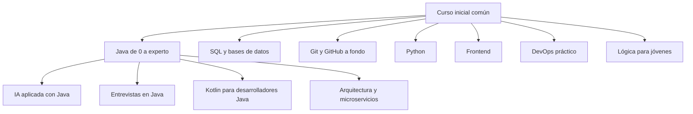
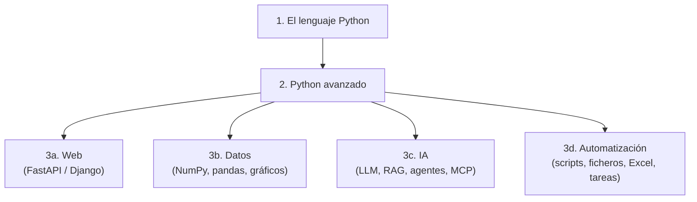
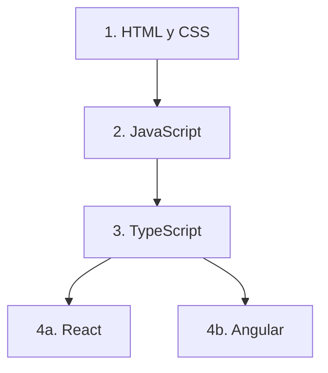

# Plan del Proyecto Academia

> Plan general, 8 de noviembre de 2026. Sale de la propuesta de nuevos cursos escrita al terminar el curso de Java (`PROPUESTA-NUEVOS-CURSOS.md` del curso original) y de las dos sesiones de planificación con el autor de ese día (la segunda revisó el plan entero: proyecto libre y gratuito, academia como «juego» y cursos como «DLC», pack base 1.0).
> Dónde estamos y qué toca ahora: [`ESTADO.md`](ESTADO.md). Estructura y normas de la carpeta: [`README.md`](README.md).

## 1. Objetivo

Una **academia de programación libre, gratuita y de código abierto** que funciona como **un juego con DLC**:

- **La plataforma es el juego**: se instala una vez, con cuentas de usuario y seguimiento de lo estudiado.
- **Cada curso es una expansión (DLC)**: vive en su propio repositorio, se instala en la academia en una versión concreta, se actualiza sin perder el progreso y **cualquiera puede crear el suyo**.
- **Todo es gratis**: la plataforma y los cursos. No hay pagos, suscripciones ni partes de pago.

Para quién y para qué:

- El autor la usa para estudiar en su máquina; **cualquiera puede descargarla y usarla**; y es un **proyecto de portfolio** publicado en GitHub, donde se va viendo crecer versión a versión.
- El autor trabaja **solo** por ahora, con una sesión de Claude por proyecto; el plan vale igual si mañana se suma más gente (apartado 2, decisión 18).

Los cursos:

- **No repiten** lo básico: lo común está en un **curso inicial** recomendado para todos.
- Comparten **la misma estructura, nombres y formato**, porque **se hacen para la academia**: `FORMATO.md` define lo que la academia necesita y todo curso lo cumple.
- Se escriben con **el mismo método** que el curso de Java original (plan, plantilla, verificación de todo el código, un commit por módulo, revisión del autor por fase), recogido en un **kit de herramientas**.

**Regla para crecer:** añadir un curso nuevo **no requiere tocar el código de la academia**. Basta con crear su repositorio, escribirlo según `FORMATO.md`, pasar la comprobación del kit e instalarlo.

El curso de Java original y Code Academy fueron el aprendizaje; este proyecto es lo de verdad y **aprovecha todo** lo que se construyó en ellos.

## 2. Decisiones tomadas (8 de noviembre de 2026)

**Estructura y proyectos**

1. **Estructura**: `Proyecto Academia/` agrupa `Academia/` y `Cursos/`; dentro de `Cursos/` van `kit-cursos/` y un proyecto por curso. Cada proyecto, su repositorio. La raíz es un repositorio pequeño con la planificación común. Rutas relativas siempre, para poder copiar la carpeta entera (ver `README.md`).
2. **Kit de herramientas** (`Cursos/kit-cursos/`): los cursos lo usan desde `../kit-cursos/`, sin copiarlo. Se hace **lo justo** para el curso inicial y se mejora cuando lo pida el siguiente curso. Tiene **una parte mínima pública** (`FORMATO.md`, plantilla de curso y comprobador) para que cualquiera pueda crear un curso; las herramientas avanzadas (verificar todo el código, generar índices y chuletas) son el método del autor, públicas pero opcionales.
3. **Curso inicial común** (`Cursos/curso-inicial/`, nombre público por decidir): lo común a todos los cursos. Es **recomendado**, no obligatorio.
4. **Curso de Java nuevo** (`Cursos/curso-java/`, **opción A**): copia del curso de Java original **con su historial**, adaptada para empezar donde acaba el curso inicial y con la estructura común. Cuando esté hecho no referencia ni necesita el original. Que es la segunda edición se dice en su `README.md` y su historial, no en el nombre.
5. **Academia** (`Academia/`): copia de Code Academy **con su historial**, que ya tiene hechos sus hitos H1 a H5 (apartado 8.5). Empieza **sin alumnos**.
6. **Los proyectos de origen se quedan como archivo**: `Curso Java Completo` y `Code Academy` no se modifican.

**Producto**

7. **Libre, gratuito y de código abierto**: la academia y los cursos. Licencias: **MIT** para la academia, el kit y el código de los cursos; **CC BY-SA 4.0** para el texto de los cursos (decidido en el paso 0).
8. **Acceso libre**: cualquier usuario puede estudiar el curso y el módulo que quiera. Los requisitos entre cursos y módulos son **recomendaciones**, nunca bloqueos.
9. **Roadmaps opcionales**: rutas de aprendizaje dentro de un curso y entre cursos (por ejemplo, «Backend con Java: inicial → Java → SQL → Git a fondo → DevOps»). Se definen como datos, no como código.
10. **Varios usuarios con cuentas** y seguimiento propio (por módulo, curso, parte y roadmap), con **roles de administrador y usuario** (apartado 8.5).
11. **Diseñada como si fuera a desplegarse en internet**, aunque hoy se use en local. Tres niveles de uso con la misma aplicación: en tu máquina, en la red de casa y, en el futuro, en un servidor (apartado 8.5).
12. **Los cursos se instalan como DLC**: el contenido no vive en el repositorio de la academia, sino que se instala desde el repositorio de cada curso en una versión concreta.
13. **Los cursos se hacen para la academia**: `FORMATO.md` define lo que la academia necesita y todo curso lo cumple. Si un curso necesita algo que la academia no admite, primero se amplía la academia y el formato; después lo usa el curso.
14. **Los cursos tienen versión** (etiqueta de Git y registro de cambios) y se pueden actualizar conservando el progreso (apartado 8.1).
15. **Cursos grandes divididos en partes** para orientarse (Java, Python, frontend): tramos con nombre que sirven de piezas de los roadmaps. Sin precio, página aparte ni certificado (apartado 4).
16. **Retos opcionales dentro de cada curso**, al final de cada fase, para afianzar lo aprendido. No son obligatorios, no se guarda si se han superado y no bloquean nada (apartado 8.1).
17. **Frontend con React y Angular** como caminos alternativos: primero React, Angular después.

**Forma de trabajar y publicar**

18. **Se trabaja en paralelo lo que haga falta, según la gente disponible.** Cada proyecto (academia, kit o curso) lo lleva una sola sesión o persona a la vez. Los cambios en el kit y en `FORMATO.md` se hacen solo desde el proyecto del kit, y los demás los recogen después. Cada curso pasa la revisión de su responsable antes de publicarse.
19. **Pack base 1.0 primero**: **la academia más el DLC del curso inicial**, ya instalado, porque una academia sin cursos no sirve. El curso inicial es un DLC como los demás (su repositorio, su versión, el mismo instalador); solo viene de serie. Así el sistema de DLC queda probado desde el primer día. El curso de Java es el primer DLC que se publica aparte; después, el resto (apartado 7).
20. **Se publica en GitHub según se avanza**, con versiones y *releases*, registro de cambios y una hoja de ruta pública en el README de la academia.
21. **La academia se llama MyOpenAcademy** (decidido en el paso 0): sustituye a «Code Academy», que se confunde con Codecademy. No se registra la marca. La academia va en la cuenta del autor (`santi-cast/myopenacademy`, su portfolio) y los cursos y el kit en la organización `myopenacademy` de GitHub, cada uno con su propio repositorio. La carpeta se llama `Academia/` para que el nombre no afecte a ninguna ruta.
22. **Presentación en el portfolio con la metáfora del juego y los DLC**, dejando claro desde la primera línea que todo es gratis. En la documentación técnica y el código se dice «curso» o «paquete de curso», no DLC.
23. **Normas de trabajo**: el kit, lo justo; todo lo importante, escrito.

## 3. El catálogo de cursos

### 3.1. Qué conviene saber antes de cada curso

Son recomendaciones: cualquier curso se puede empezar sin haber hecho los anteriores.



| Curso | Conviene saber antes | Tamaño aprox. (módulos) |
|---|---|---|
| **Curso inicial común** | Nada | 31 |
| **Java de 0 a experto** | Curso inicial | unos 190 (ya escritos) |
| **SQL y bases de datos** | Curso inicial | 40-50 |
| **Git y GitHub a fondo** | Curso inicial | 15-20 |
| **Python** | Curso inicial | 50-70 el tronco; 15-35 cada rama |
| **Frontend** | Curso inicial | 60-80, más 20-25 por *framework* |
| **DevOps práctico** | Curso inicial | 40-50 |
| **Lógica de programación para jóvenes** | Nada (alternativa al inicial) | 20-30 |
| **IA aplicada con Java** | Curso inicial y saber Java | 40-60 |
| **Entrevistas técnicas en Java** | Curso inicial y saber Java | 40-50 |
| **Kotlin para desarrolladores Java** | Curso inicial y saber Java | 50-70 |
| **Arquitectura y microservicios** | Curso inicial y saber Java | 50-70 |

«Saber Java» puede venir de nuestro curso o de otro sitio. «Spring Boot para quien ya sabe Java» no es un curso aparte: es la **parte 4 del curso de Java**.

### 3.2. Los cursos, uno a uno

#### Curso inicial común

Ver el apartado 5.

#### Java de 0 a experto

Ver el apartado 6.

#### SQL y bases de datos de 0 a experto

- **Público:** programadores de cualquier lenguaje, analistas de datos, perfiles de negocio.
- **Temario esbozado:** modelo relacional · SQL desde cero hasta consultas avanzadas (ventanas, CTE recursivas) · diseño y normalización · índices y planes de ejecución · transacciones y concurrencia · PostgreSQL a fondo · NoSQL (MongoDB y Redis) · copias de seguridad y administración básica · SQL para análisis de datos.
- **Reutiliza:** la fase 09 del curso de Java como esqueleto, **reescrita para quien no programa** (solo puede dar por sabido el curso inicial), y `bases_de_datos.py`, que ya ejecuta SQL de verdad en PostgreSQL y MySQL.
- **Decisión pendiente:** PostgreSQL y MySQL, o añadir SQLite (sin instalación, ideal para empezar).
- **Datos de ejemplo** realistas (una tienda, una biblioteca, unos pedidos) que crecen a lo largo del curso.
- **Por qué:** no depende de Java, se termina pronto y atrae público nuevo.

#### Git y GitHub a fondo

- **Público:** cualquiera que programe. Lo básico de Git está en el curso inicial; este es el siguiente paso.
- **Temario esbozado:** Git por dentro (commits, árboles, referencias) · reescribir y reparar el historial (`rebase`, `cherry-pick`, `bisect`, `reflog`) · formas de trabajar en equipo (*trunk-based*, *GitHub Flow*, *Git Flow*) · *pull requests*, revisión de código, *issues*, proyectos, protección de ramas · GitHub Actions básico · seguridad (secretos filtrados, `gitleaks`, commits firmados) · colaborar en código abierto · caso real en equipo.
- **Reutiliza:** los módulos de Git del curso de Java y la sesión de `gitleaks` de su fase 20.
- **Por qué:** corto, útil para todos y buena puerta de entrada.

#### Python

Un tronco común y ramas según para qué lo quiera el alumno:



| Parte | Qué lleva | Tamaño aprox. |
|---|---|---|
| 1. El lenguaje | Fundamentos, colecciones, funciones, POO, módulos, entornos virtuales, errores, ficheros | 30-40 |
| 2. Python avanzado | Tipado, generadores, decoradores, concurrencia, pytest, empaquetar | 20-30 |
| 3a. Web | APIs con FastAPI y, si se quiere, Django; bases de datos y despliegue | 25-35 |
| 3b. Datos | NumPy, pandas, limpieza de datos y gráficos | 25-35 |
| 3c. IA | LLM, RAG, agentes y MCP con el ecosistema de Python | 25-35 |
| 3d. Automatización | Scripts para el día a día: ficheros, Excel, web, tareas programadas | 15-20 |

- **Reutiliza:** el método entero; las herramientas del kit ya están en Python, así que su ejecutor es el más fácil. La rama web se apoya en SQL, Git y DevOps; la de IA, en los conceptos de la fase 19 del curso de Java.
- No hace falta hacerlo entero: las partes 1 y 2 ya tienen salida y cada rama se publica cuando esté lista.

#### Frontend



| Parte | Qué lleva | Al acabar, el alumno… |
|---|---|---|
| 1. HTML y CSS | Estructura, semántica, formularios, accesibilidad, *flexbox*, *grid*, diseño adaptable | Maqueta una página a partir de un diseño |
| 2. JavaScript | El lenguaje, DOM, eventos, `fetch`, promesas, `async`/`await`, módulos, npm y Vite | Hace páginas interactivas que hablan con una API |
| 3. TypeScript | Tipos, interfaces, genéricos, proyectos grandes | Escribe JavaScript con menos errores |
| 4a. React / 4b. Angular | Componentes, estado, rutas, formularios, APIs REST, JWT, pruebas y despliegue | Hace aplicaciones web completas |

- React y Angular son **caminos alternativos**; las dos partes hacen la misma aplicación contra la misma API y se puede cerrar con «React frente a Angular».
- **Primero React** (más demanda general) y **Angular después** (muy usado en España en empresas con backend Java).
- Lo caro es mantenerlos: Angular saca versión importante cada seis meses y React cambia sus recomendaciones a menudo.
- **Reutiliza:** la fase 10 del curso de Java, `paginas.py`, `navegador.py` y las APIs del proyecto evolutivo.
- Las partes 1 y 2 sirven también por separado.

#### DevOps práctico

- **Público:** programadores que quieren desplegar lo que hacen; perfiles de sistemas que se acercan al desarrollo.
- **Temario esbozado:** Linux · Docker y Compose · CI/CD con GitHub Actions · infraestructura como código · Kubernetes · observabilidad · seguridad (secretos, gitleaks, imágenes) · nube (costes fechados). Git a fondo tiene su propio curso.
- **Reutiliza:** las fases 18 y 20 del curso de Java, `servidor_linux.py`, `contenedores.py` y `plataformas.py`.

#### IA aplicada para programadores Java (con Spring AI)

- **Temario esbozado:** LLM para programadores (tokens, contexto, temperatura, coste) · prompts como código · salida estructurada · *function calling* · RAG de verdad (troceado, *embeddings*, almacenes vectoriales, recuperación híbrida, reordenación) · evaluación y pruebas automáticas · agentes · MCP (cliente y servidor) · memoria de conversación · seguridad (inyección de *prompts*, datos sensibles) · Ollama frente a modelos de pago · observabilidad · despliegue · proyecto final: un asistente para una empresa ficticia.
- **Reutiliza:** la fase 19 del curso de Java, `modelos_ia.py` y el proyecto evolutivo. Da por sabido el módulo «Qué es la IA» del curso inicial.
- **Decisiones pendientes:** qué conviene saber antes exactamente (¿saber Java o hasta la parte 4, Spring Boot?) · ¿solo modelos locales o también de pago? (propuesta: locales para los ejemplos verificados y de pago como alternativa explicada) · almacén vectorial (propuesta: PGvector) · proyecto evolutivo (propuesta: el asistente de la empresa ficticia del curso de Java).
- **Problema que hay que resolver antes de escribir:** las respuestas de un modelo no son siempre iguales. La fase 19 da la pista: modelos locales fijos, temperatura baja, salida estructurada comprobada por su forma y no por su texto, y partes variables. Se diseña y se prueba antes del primer módulo.

#### Entrevistas técnicas en Java

- **Temario esbozado:** procesos de selección · Big O · estructuras de datos y algoritmos · patrones de problemas (dos punteros, ventana deslizante, BFS/DFS, programación dinámica) · preguntas típicas de Java, Spring y bases de datos · diseño de sistemas básico · prueba técnica para casa · simulacros.
- **Reutiliza:** las fases 02 a 07 y 20 del curso de Java.
- **Por qué:** se puede **corregir automáticamente** con tests.

#### Kotlin para desarrolladores Java

- **Temario esbozado:** de Java a Kotlin · colecciones y funcional · corrutinas frente a hilos virtuales · interoperabilidad · Gradle con Kotlin DSL · Spring Boot con Kotlin · testing (JUnit, MockK, Kotest) · el proyecto evolutivo en Kotlin.
- **Alternativa a valorar:** «Kotlin desde cero», que solo recomendaría el curso inicial (público de Android).

#### Arquitectura de software y microservicios

- **Temario esbozado:** diseño a escala · DDD · hexagonal y limpia · monolito modular (Spring Modulith) · microservicios: cuándo sí y cuándo no · eventos, *outbox*, sagas, CQRS · resiliencia · observabilidad · Kubernetes · seguridad entre servicios · ADR · caso real.
- **Reutiliza:** las fases 16, 17 y 18 del curso de Java. Para perfiles senior.

#### Lógica de programación para jóvenes

- Para adolescentes o principiantes que se asustan con un curso largo. Reutiliza la primera fase del curso inicial con otro tono, más juego y menos teoría.

## 4. Cursos por partes

- El curso se **escribe y se mantiene como uno solo** (un repositorio, una verificación, un proyecto evolutivo) y se **divide en partes con nombre** para orientarse: alguien puede decir «quiero estudiar Spring Boot» y ver por dónde empezar y qué conviene saber antes.
- Las partes son **piezas de los roadmaps** (por ejemplo, «inicial → Java parte 1 → SQL → Java parte 4»). No tienen precio, página aparte ni certificado; la academia muestra el avance de cada una.
- No se divide en «básico, intermedio y avanzado», sino **por lo que se aprende**.
- **Se dividen:** Java, Python y frontend. **Quizá:** arquitectura y Kotlin, si pasan de unos 60 módulos. **No:** curso inicial, SQL, Git, entrevistas e IA con Java.

**Borrador para Java** (por los nombres de las fases; hay que comprobar que cada corte cae en un sitio natural):

| Parte | Fases del curso original | Qué sabe hacer el alumno al acabar |
|---|---|---|
| 1. El lenguaje Java | 01 (lo que queda) a 05 | Programar en Java: fundamentos, POO, colecciones, funcional |
| 2. Java avanzado | 06 a 08 | Concurrencia, redes, reflexión, patrones, interfaces gráficas |
| 3. Datos y web | 09 y 10 | Bases de datos y web sin *frameworks* |
| 4. Spring Boot | 11 a 16 | Aplicaciones y APIs profesionales con Spring |
| 5. Microservicios, despliegue e IA | 17 a 19 | Llevar aplicaciones a producción y añadirles IA |
| 6. Desarrollo profesional | 20 | Trabajar en equipo, entrevistas, portfolio |

## 5. El curso inicial común

### 5.1. Regla para decidir qué entra

Un tema va al curso inicial solo si las tres respuestas son sí:

1. ¿Lo necesitan **todos** los cursos?
2. ¿Se puede explicar **sin un lenguaje concreto**?
3. ¿Le sirve al alumno **antes** de empezar su curso?

Si no, va al curso que lo use. Ejemplo: el despliegue cumple la 1 pero no la 2, así que aquí solo va la idea (y GitHub Pages en el proyecto final); Docker, servidores y nube van a cada curso y a DevOps.

### 5.2. Temario: 8 fases y 31 módulos

Con la estructura común, las agrupaciones del curso inicial son **fases** (`fase-01-…` a `fase-08-…`), como en todos los cursos. Cada fase termina con sus **retos opcionales** (apartado 8.1); qué tipo de retos lleva depende de la decisión 5 del apartado 10 (pseudocódigo o un lenguaje real).

♻️ = se adapta del curso de Java original (número de módulo original) · 🆕 = nuevo

| # | Fase | Módulo | Origen |
|---|---|---|---|
| 1 | **1. Qué es programar** | Qué es programar | ♻️ 00.01 |
| 2 | | Algoritmos y pseudocódigo | ♻️ 00.02 |
| 3 | | ¿Cómo sé que funciona? Probar un programa | 🆕 |
| 4 | | Paradigmas de programación | ♻️ 00.03 |
| 5 | **2. Tu ordenador por dentro** | Cómo funciona un ordenador | 🆕 |
| 6 | | Archivos, carpetas y rutas | 🆕 |
| 7 | | Instalar programas, variables de entorno y PATH | 🆕 |
| 8 | **3. Herramientas del programador** | La terminal: lo básico | ♻️ 01.04 |
| 9 | | La terminal: sacarle partido | ♻️ parte general de 18.01 |
| 10 | | El editor de código | 🆕 |
| 11 | | Errores y depuración | ♻️ parte general de 02.12 |
| 12 | **4. Formatos y diagramas** | Texto, binario y codificación | 🆕 |
| 13 | | Markdown | 🆕 |
| 14 | | JSON y YAML | ♻️ parte general de 04.11 |
| 15 | | XML, CSV y otros | ♻️ parte general de 04.11 |
| 16 | | Diagramas y Mermaid | ♻️ parte general de 03.11 |
| 17 | **5. Git y GitHub** | Git: fundamentos | ♻️ 01.05 |
| 18 | | Ramas y conflictos | ♻️ 01.06 |
| 19 | | GitHub | ♻️ 01.07 |
| 20 | **6. Internet y aplicaciones** | Redes: IP, router, DNS y cortafuegos | ♻️ parte general de 06.05 |
| 21 | | Puertos y `localhost`: tu ordenador como servidor | 🆕 |
| 22 | | La web: HTTP, peticiones, respuestas y APIs | ♻️ 10.01, 10.02 y 10.08 |
| 23 | | Qué es una base de datos | ♻️ 09.01 y 09.02 |
| 24 | | Las piezas de una aplicación | 🆕 |
| 25 | | Qué es la IA y cómo funciona por dentro | ♻️ 19.01 |
| 26 | **7. Aprender a aprender** | Cómo estudiar con estos cursos | 🆕 |
| 27 | | Organizar tu trabajo | ♻️ parte general de 20.03 |
| 28 | | Buscar ayuda | ♻️ parte general de 02.08 |
| 29 | | Programar con asistentes de IA | ♻️ 20.01 |
| 30 | | Seguridad básica | ♻️ partes generales de 14.01 y 14.06 |
| 31 | **8. Proyecto final** | Tu primer repositorio | 🆕 (ideas de 20.06) |

Unos **19 se adaptan** y unos **12 son nuevos de verdad**.

### 5.3. Qué lleva cada módulo nuevo o ampliado

- **Probar un programa:** caso de prueba (entrada, salida esperada, salida real) · pensar los casos antes de programar (normal, límites, los que deben fallar) · probar a mano un algoritmo con una tabla · qué son las pruebas automáticas · la idea de TDD. Si se mete un lenguaje real, termina con una prueba automática sencilla. Ayuda a entender los mensajes de un corrector automático.
- **Cómo funciona un ordenador:** procesador, memoria, disco, sistema operativo.
- **Archivos, carpetas y rutas:** incluidas las rutas relativas y absolutas.
- **Instalar programas:** instaladores, gestores de paquetes, variables de entorno y PATH.
- **Terminal, lo básico:** qué es · `pwd`, `ls`, `cd` · crear, copiar, mover y borrar (sin papelera) · ver y buscar en ficheros · `--help` y `man`.
- **Terminal, sacarle partido:** redirecciones y tuberías · variables de entorno y PATH en la práctica · permisos y cuándo **no** ser administrador · procesos (ver y parar) · un *script* sencillo.
- **El editor de código:** VS Code, extensiones y atajos.
- **Errores y depuración:** leer un mensaje de error sin asustarse · aislar el problema · el patito de goma · la idea de un depurador con puntos de parada.
- **Texto, binario y codificación:** extensiones, UTF-8 y las tildes, saltos de línea en Windows y Linux.
- **Markdown:** títulos, listas, enlaces, código y tablas.
- **JSON y YAML:** objetos, listas, tipos, errores típicos (comas, sangría), por qué YAML es delicado con los espacios.
- **XML, CSV y otros:** etiquetas y atributos; las trampas de CSV (separadores, comillas); un vistazo a `.properties`, `.env` y TOML. HTML solo como «otro lenguaje de marcas».
- **Diagramas y Mermaid:** por qué se dibuja antes de programar · diagramas de flujo y de bloques · Mermaid dentro de Markdown (GitHub los dibuja) · que existen UML y otros.
- **Redes:** el router · IP pública y privada, IPv4 e IPv6, `127.0.0.1` · DNS · TCP y UDP en una idea · cortafuegos · `ping`, `nslookup` y `curl`. Sin subredes, máscaras ni el modelo OSI capa por capa.
- **Puertos y `localhost`:** `localhost:8080`, «el puerto ya está en uso», tu ordenador como servidor.
- **La web:** URL, HTTP, peticiones y respuestas, qué es una API, probar APIs sin programar.
- **Qué es una base de datos:** qué es, tablas frente a documentos, para qué sirve cada tipo. Sin SQL.
- **Las piezas de una aplicación:** frontend, backend, base de datos, API y nube con un ejemplo real (comprar en una tienda online) · un programa entero o varios que se hablan · **qué es desplegar** (servidor, dominio, *hosting*, nube) · **qué curso de la academia enseña cada pieza** (orienta al alumno sobre qué hacer después).
- **Qué es la IA:** un modelo de lenguaje predice texto, no «sabe» · alucinaciones · contexto y por qué no siempre responde igual · privacidad (qué no pegar nunca en un chat de IA) · nube frente a local. Sin APIs, RAG ni agentes.
- **Cómo estudiar:** teoría, ejemplos, ejercicios, retos y chuletas; sesiones cortas, descansos, registro de lo aprendido; cómo usar la academia (acceso libre, roadmaps, seguimiento).
- **Organizar tu trabajo:** dividir un problema en tareas · tablero Kanban · GitHub Issues y Projects · que existen Trello, Notion y Jira. Sin Scrum.
- **Buscar ayuda:** documentación oficial, buscadores, foros, cómo hacer una buena pregunta.
- **Programar con asistentes de IA:** pedir bien · comprobar siempre lo que da (con los casos de prueba de la fase 1) · usarla como profesor y no para que haga los deberes · normas de la academia sobre la IA (las decide el autor).
- **Seguridad básica:** contraseñas, doble factor, no subir secretos a GitHub.
- **Proyecto final:** un repositorio propio **planificado con *issues* en un tablero de GitHub**, con README en Markdown, datos en JSON, un diagrama en Mermaid, historial en Git y **publicado en GitHub Pages** (obligatorio: el alumno termina con algo suyo en internet). Es el proyecto para el portfolio del alumno que pide el contrato (apartado 8.1).

### 5.4. Para que no se haga largo

- **Fases imprescindibles** (1, 2, 3, 5 y 8) y **recomendadas** (4, 6 y 7), que se pueden hacer en paralelo con el curso siguiente. Con el acceso libre, quien ya sepa algo se salta la fase sin más.
- **Está en el límite de tamaño.** Lo que se añada debería sustituir algo o ir como «recomendado».

## 6. El curso de Java nuevo (`curso-java/`)

Es el **primer DLC** después del pack base (apartado 7).

### 6.1. Adaptar, no empezar de cero

Del curso original sale una parte pequeña; el resto se queda. Adaptando se conserva lo verificado (código compilado, salidas comprobadas, versiones, la revisión del autor fase a fase) y no se pierden ajustes por el camino. Empezar de cero solo compensaría si cambiara la estructura, el enfoque o la base (eso sería una tercera edición).

### 6.2. Qué va a cada sitio

| Del curso de Java original | Va a |
|---|---|
| Fase 00 entera (3 módulos) | `curso-inicial` |
| 01.04 Terminal y 01.05-01.07 Git y GitHub | `curso-inicial` |
| La parte general de 02.08, 02.12, 03.11, 04.11, 06.05, 09.01, 09.02, 10.01, 10.02, 10.08, 14.01, 14.06, 18.01, 19.01, 20.01 y 20.03 | `curso-inicial`; en `curso-java` se queda lo de Java, con un enlace al inicial |
| El resto de los 199 módulos, `codigo/` y las 14 etapas de `proyecto/` | `curso-java` |
| Índice, chuleta global, roadmaps y ruta mínima | `curso-java`, regenerados |
| `herramientas/` | `kit-cursos` (lo genérico) y `curso-java` (lo de Java: capturas de JavaFX y Swing, Gradle) |
| `PLAN-CURSO.md`, `CLAUDE.md`, `ESTADO.md` | `kit-cursos` como plantillas; `curso-java`, lo suyo |
| Historial de Git | `curso-java` (se crea copiando el repositorio) |

### 6.3. Cómo

1. Crear `Cursos/curso-java/` **clonando el curso original con su historial**, sin tocar el original.
2. Quitar lo que pasa al inicial y rehacer el arranque: el curso empieza por instalar el JDK y recomienda «haber hecho el curso inicial».
   - **Terminal:** el curso original pone PowerShell y bash lado a lado (en el 01.04 y otros módulos). Como el curso inicial enseña **bash para todos** (Git Bash en Windows), se pasa a bash y se enlaza al inicial (decisión 9 del apartado 10). Revisar también lo que no funcione en el bash 3.2 de macOS, las salidas de Git y otros comandos (en español) y la rama principal (`main`).
3. Recortar la parte general de los módulos de la tabla y enlazar al inicial (con el formato de enlace entre cursos del contrato, apartado 8.1).
4. Donde se explica JSON, XML o YAML por primera vez (Maven, web, Spring, despliegue), resumir y enlazar al inicial.
5. Revisar enlaces y menciones a lo quitado: medido el 8 de noviembre de 2026, **66 ficheros con 226 enlaces** a las fases 00 y 01 y **unas 70 menciones en el texto** («fase 0», «módulo 01.x»). Los enlaces los señala la comprobación de enlaces; las menciones hay que leerlas una a una (lo más incierto de la adaptación).
6. Ponerlo con la estructura común del `FORMATO.md` (incluidas las secciones nuevas del módulo y los retos de cada fase) y que pase la comprobación de la academia.
7. Índice, chuleta, roadmaps, ruta mínima, proyecto y verificación entera, como en un cierre de fase.
8. Su `README.md` dice que es la segunda edición; a partir de ahí no referencia el curso original.

## 7. Orden de trabajo

Es el orden en que se hacen las cosas, no el que sigue el alumno. Se trabaja en paralelo lo que haga falta (decisión 18).

| # | Qué | Dónde | Por qué en este puesto |
|---|---|---|---|
| 0 | **Contrato de formato** (unas dos sesiones) | Sesión en esta carpeta | Decisiones que afectan a cursos y academia (apartado 8.1); evita rehacer el kit o la academia |
| 1 | **Kit mínimo** y **fase 1 del curso inicial** | `Cursos/kit-cursos/` y `Cursos/curso-inicial/` | Hace falta para escribir cualquier curso. Lo justo |
| 2 | **Prueba de importación** | Copia de la academia | Importar la fase 1 del inicial para comprobar pronto que el formato funciona, antes de escribir el resto |
| 3 | **Resto del curso inicial** y **academia** | `Cursos/curso-inicial/` y `Academia/`, en paralelo | La academia se adapta ya con un curso real; antes, el autor la usa para estudiar (hito H6 de Code Academy) |
| 4 | **Pack base 1.0 publicado en GitHub** | | La academia más el DLC del curso inicial, con licencias, README y revisión previa (apartado 8.6) |
| 5 | **Curso de Java**, primer DLC | `Cursos/curso-java/` | Empieza donde acaba el inicial y casi todo está escrito |
| 6 | **SQL** | `Cursos/curso-sql/` | Rápido, solo recomienda el inicial, atrae público nuevo |
| 7 | **Git y GitHub a fondo** | `Cursos/curso-git/` | Corto, amplía público |
| 8 | **Python, partes 1 y 2** | `Cursos/curso-python/` | El lenguaje más demandado |
| 9 | **IA aplicada con Java** | `Cursos/curso-ia-java/` | Siguiente paso tras Java, con el kit ya rodado |
| 10 | **Entrevistas en Java** | `Cursos/curso-entrevistas-java/` | Corrección automática, mucha reutilización |
| 11 | **Según el interés del autor** | | Frontend (React y luego Angular) · Kotlin · Arquitectura · ramas de Python · DevOps |
| 12 | **Si apetece** | | Lógica para jóvenes |

Los puestos 6 a 12 son orientativos, igual que los nombres de las carpetas de los cursos futuros. Cada curso y cada versión de la academia se publican en GitHub con su versión.

## 8. Cómo se hace cada paso

### 8.1. Paso 0: el contrato de formato

> **Hecho el 8 de noviembre de 2026.** El resultado es `Cursos/kit-cursos/FORMATO.md` (versión 1 del formato), en el repositorio del kit. Lo que sigue es cómo se planteó.

Una o dos sesiones en esta carpeta, con acceso de solo lectura a `../Curso Java Completo/` y `../Code Academy/`, para escribir el **`FORMATO.md`** que cumplirán todos los cursos y que la academia sabrá instalar.

- **Manda la academia**: el contrato recoge lo que la academia necesita para importar y mostrar un curso. El curso de Java original sigue siendo el modelo de estructura, porque Code Academy se hizo a su medida.
- **No parte de cero**: formaliza y amplía el manifiesto de Code Academy (`docs/manifiesto.md`, versión 2).
- **Se escribe para que lo lea cualquiera**, no solo las sesiones de Claude, porque es la base para que otras personas creen cursos.
- **Lleva versión.** Cuando cambia, se anota qué cursos hay que poner al día. Solo se cambia desde el proyecto del kit.
- **Deja sitio a todo lo que vendrá** (roadmaps, equivalencias, corrección automática, conceptos), aunque el pack base 1.0 solo implemente lo imprescindible.

**Lo que la academia ya exige hoy** (visto en Code Academy el 8 de noviembre de 2026):

- Un importador sin conexión (`backend/content-import`) copia el curso **desde un commit fijo** a una carpeta de contenido con un `manifest.json`; nunca lee el curso en directo. La ruta del curso se le pasa como argumento.
- El manifiesto da **identificadores permanentes** con prefijo de curso (`java-02.01`, `java-phase-02`) a fases, lecciones, ejercicios, recursos y etapas; el progreso de los alumnos va con ellos.
- Una herramienta de actualización (`backend/content-update`) **compara antes de aplicar**. Admite altas, ejercicios nuevos y cambios de orden o de fase; **rechaza** retítulos, retiradas, divisiones, fusiones e identidades ambiguas, y no traslada progreso.
- `00-indice.md` con encabezados `## Fase NN — Título`.
- En cada módulo, la sección exacta **«Ejercicios prácticos resueltos»**, con **«Ejercicio N · Título»** y la solución en `<details>`. El título del ejercicio es su identidad: el importador es muy estricto con esta sección.
- Enlaces relativos que se puedan resolver, carpetas de código (las convierte en ZIP) e imágenes PNG, JPG o SVG locales.
- Mermaid con límites: sin negrita ni cursiva en las etiquetas y solo las entidades `&quot;`, `&lt;`, `&gt;` y `&amp;`.
- Etapas del proyecto evolutivo aparte de las lecciones (un curso puede no tener proyecto).
- **No tiene** corrección automática de ejercicios ni tiempos por módulo: los estados los marca el alumno a mano.

**Lo que hay que decidir en el contrato:**

1. **Estructura común** de carpetas y nombres, copiada del curso de Java (incluidos los nombres exactos de la chuleta global, los roadmaps y la ruta mínima).
2. **Enlaces entre cursos** (lo más importante): cómo enlaza el curso de Java a un módulo del curso inicial de forma que funcione en GitHub, que el kit lo compruebe y que la academia lo convierta en un enlace a la lección del otro curso. Hoy el importador solo resuelve enlaces dentro del mismo curso. Con el acceso libre, son lo que permite entrar a un módulo suelto sin perderse.
3. **Nombres estables**: cerrar temario y nombres de fichero antes de escribir; cómo se anota un renombrado.
4. **Datos de cada módulo** que pueda leer la academia y dónde van: tiempo estimado, nivel, parte a la que pertenece y **«qué conviene saber antes»**, con enlaces a módulos de cualquier curso. Dejar sitio para declarar **conceptos** (por si en el futuro se cruzan con el glosario).
5. **Secciones fijas del módulo**, sobre la plantilla actual (Qué aprenderás · Teoría · Ejemplos · Errores típicos · Buenas prácticas · Ejercicios prácticos resueltos · Chuleta):
   - **Objetivos** al principio (la sección «Qué aprenderás» ya existe) y **qué conviene saber antes**.
   - **Pistas** plegadas entre el enunciado y la solución de cada ejercicio.
   - **Preguntas de repaso** al final, de autoevaluación, con formato fijo para que la academia pueda mostrarlas como test.
6. **Retos al final de cada fase**: una sección con nombre exacto (propuesta: «Retos para afianzar») y encabezados «Reto N · Título», con solución en `<details>` y, si se quiere, pistas. Mezclan lo aprendido en varios módulos de la fase, son **opcionales** y **sin seguimiento**: el importador no debe confundirlos con ejercicios ni guardarles estado. El kit verifica sus soluciones como cualquier código del curso.
7. **Sitio para los tests de los ejercicios**, para que la corrección automática sea posible en el futuro sin romper los cursos que no la usen.
8. **Proyecto para el portfolio del alumno** obligatorio en todo curso, aunque sea pequeño (el proyecto evolutivo en Java; el repositorio en GitHub Pages en el inicial).
9. **Glosario común**: los términos se definen una vez (casi siempre en el curso inicial) y los demás cursos enlazan a la definición. Dónde vive y cómo se enlaza.
10. **Roadmaps entre cursos**: dónde y en qué formato se definen. Propuesta: un fichero común de datos que la academia importa, legible también en GitHub.
11. **Versiones de los cursos**:
    - Cada curso tiene versión (etiqueta de Git, por ejemplo `v1.2.0`) y registro de cambios (`CHANGELOG.md`). Esa etiqueta es lo que se instala en la academia.
    - **Cambios menores** (erratas, mejoras de texto, ejercicios o módulos nuevos): se reinstalan sin más.
    - **Cambios de estructura** (renombrar, dividir, unir o retirar módulos): se permiten si el curso trae un **fichero de equivalencias** (identificador viejo → nuevo) para trasladar el progreso. Un módulo retirado se marca como retirado, no se borra, y quien lo hizo lo conserva en su historial.
    - **Edición nueva** (curso reescrito): puede convivir con la anterior o sustituirla, con equivalencias donde se pueda.
    - Antes de cerrarlo, leer `docs/actualizacion-contenido.md` de Code Academy.
12. **Ficheros obligatorios de cada repositorio de curso**: `README.md`, licencia, guía de contribución (`CONTRIBUTING.md`) y `CHANGELOG.md`.
13. Qué comprueba el kit para asegurar que un curso **se puede instalar** en la academia, con **mensajes de error claros** («al módulo 03.02 le falta la sección de ejercicios», no solo «importación rechazada»).
14. **Tipo de paquete**: de momento solo «curso», pero con el campo previsto por si algún día hay otros.

Los puntos 2, 4, 6, 7, 10 y 11 implican cambios en el importador de la academia: se deciden pensando en los dos lados.

### 8.2. Paso 1: el kit de herramientas

`Cursos/kit-cursos/`, con todo lo que no es de Java, sacado del curso original:

```
kit-cursos/
├── README.md                 ← cómo arrancar un curso nuevo, paso a paso
├── FORMATO.md                ← el contrato del paso 0
├── plantillas/               ← CLAUDE.md, PLAN-CURSO.md, ESTADO.md, módulo tipo, retos de fase,
│                               README, licencia, CONTRIBUTING y CHANGELOG, con huecos
└── herramientas/
    ├── README.md
    ├── nucleo/               ← verificar_codigo, generar_modulo, generar_indice, generar_chuleta_global,
    │                           comprobar_enlaces, comprobar_mermaid, argumentos
    ├── servicios/            ← bases_de_datos, contenedores, servidor_linux, plataformas,
    │                           paginas, navegador, modelos_ia
    ├── lenguajes/            ← un ejecutor por lenguaje: java, sql, node… (python, kotlin, typescript cuando hagan falta)
    └── formato_academia.py   ← comprueba que un curso cumple FORMATO.md y se puede instalar
```

- **Parte mínima pública** (`FORMATO.md`, plantilla y `formato_academia.py`): documentada para personas, sencilla y sin instalar nada raro. Es lo único que necesita quien quiera crear su curso.
- La pieza difícil es **`verificar_codigo.py`** (unas 1.500 líneas): mezcla lo genérico (bloques del módulo, comparación con `codigo/`, salidas, partes variables, código sin enlazar) con lo de Java (`javac`, Maven, Gradle, JUnit, JavaFX, Swing, Spring Boot). Se separa en un núcleo y **ejecutores** con una interfaz pequeña: «¿este fichero es mío?», «compílalo», «ejecútalo y dame su salida», «ejecuta sus pruebas». Los ejecutores de SQL, Node, páginas, Compose, Linux y plataformas ya están casi separados.
- **Lo justo:** separar solo lo que necesite el curso inicial (más comprobadores de formatos para sus ejercicios: JSON, YAML, XML, CSV, Markdown, y quizá comandos de terminal) y mejorarlo cuando lo pida el siguiente curso.
- **Prueba de fiabilidad:** sobre una copia del curso de Java, el kit debe dar el mismo resultado que las herramientas originales.
- Cada herramienta, documentada en `herramientas/README.md` y en su propia ayuda.

**Lecciones del curso de Java que pasan al kit:** verificar el módulo al terminarlo y la fase al cerrarla · fechar en el texto los datos que caducan · cierre de fase con verificación entera, enlaces y Mermaid · documentar cada herramienta · Mermaid necesita Node (cada máquina indica dónde, con una variable de entorno, no en el código).

### 8.3. Paso 2: arrancar cualquier curso con el kit

1. Crear el repositorio en `Cursos/` y rellenar las plantillas (incluidos licencia, `CONTRIBUTING.md` y `CHANGELOG.md`).
2. Decisiones generales con el autor: público, profundidad, versiones exactas, herramientas, IDE, idioma de los identificadores.
3. Verificar versiones en la documentación oficial y anotarlas con su fecha.
4. Temario completo, fase a fase y módulo a módulo, con tiempos, retos de cada fase y el proyecto para el portfolio; **nombres de fichero cerrados**.
5. Revisión del autor del plan entero antes de escribir nada.
6. Ejecutor del lenguaje, si no existe, con sus pruebas y documentado.
7. Primera fase y **parar** para que el autor revise estilo, profundidad y formato.
8. El resto, fase a fase, con las reglas de `Cursos/CLAUDE.md`.
9. Si el curso necesita algo que la academia no admite, **primero se amplía la academia y `FORMATO.md`** (desde sus proyectos) y después lo usa el curso.
10. Etiquetar la versión, instalarlo en la academia y publicarlo en GitHub.

### 8.4. Paso 3: el curso de Java

Ver el apartado 6.3.

### 8.5. Paso 4: la academia

`Academia/` se crea **clonando Code Academy con su historial**, sin tocar el original, y se adapta en su propio proyecto, con su forma de trabajar (hitos, tareas, pruebas).

#### Lo que Code Academy ya tiene (visto el 8 de noviembre de 2026)

Hitos H1 a H5 cerrados e integrados en `main`; H6 (uso real por el propietario) y H7 (publicación) pendientes. Su propio plan ya coincide con este en lo esencial: varios usuarios desde la primera versión local, objetivo de portfolio, publicación en internet como hito aparte, «una sola plataforma con estructura de cursos reutilizable» y «evitar bloquear lecciones por orden».

- **Tecnologías:** React, Vite y TypeScript; Java 25 y Spring Boot 4.1.2 con Maven Wrapper; PostgreSQL 18.6 en Docker Compose; JPA, Flyway y Spring Security. Pruebas con Vitest, JUnit con Testcontainers y Playwright (recorrido completo con dos usuarios).
- **Cuentas:** registro e inicio de sesión, contraseñas con Argon2id, CSRF, sesiones con caducidad; cookie preparada para HTTPS. Recuperación de contraseña por consola. **Sin administrador.**
- **Seguimiento:** estados manuales de lección (completada o no), de ejercicio (pendiente, en curso o resuelto) y de etapa del proyecto; avance con porcentaje; «Continuar» en la última lección; catálogo y «Mis cursos».
- **Contenido:** el curso de Java entero importado (199 lecciones y 14 etapas), Mermaid, código resaltado, soluciones desplegables, descarga de carpetas en ZIP, HTML saneado. Importador y actualización comparada (apartado 8.1).
- **Interfaz:** modo claro y oscuro (sigue al sistema), diseño adaptable a tableta y móvil, estilos de impresión.
- **Aspecto centralizado:** `frontend/src/styles/tokens.css` es el único fichero con colores, fuentes, tamaños y espaciados (unas 186 variables). El CSS de los componentes solo usa `var(--…)`, y un test (`src/styles.test.ts`) lo hace cumplir: falla si hay valores escritos directamente, variables sin definir o un tema oscuro que no redefine todos los colores del claro. Cambiar el aspecto es editar un solo fichero.
- **Configuración** privada en `.env`, fuera de Git. Todo escucha solo en `127.0.0.1`.

#### Lo que hay que añadir

**Norma que se mantiene:** todo el aspecto visual sale de las variables de `tokens.css`, y toda pantalla nueva (administración, roadmaps, retos…) las usa. El test que lo comprueba no se desactiva.

**Para el pack base 1.0:**

- **Nombre y logo en un solo sitio**, igual que los colores. Hoy «Code Academy» está escrito en `index.html` (título de la pestaña), `src/layout/Layouts.tsx` (cabecera) y una prueba (`e2e/stages.spec.ts`). Así la marca se cambia sin tocar componentes, y encaja con el ajuste «nombre de la instancia» del panel de administración.

- **Varios cursos a la vez**, con el curso inicial como recomendado y **recomendaciones entre cursos**, y **enlaces entre cursos**, **datos de cada módulo** y **retos** como extra opcional sin seguimiento, según el contrato. Ningún curso escrito en el código: el catálogo, las recomendaciones y los roadmaps salen del contenido instalado.
- **Cursos como DLC**:
  - La carpeta `content/` sale de Git y se rellena al instalar cada curso con el importador, desde una ruta local (`../Cursos/curso-xxx/`) y una versión concreta.
  - Un fichero pequeño en el repositorio dice **qué cursos y qué versión** hay instalados, para poder reproducir la instalación.
  - **Cursos de ejemplo pequeños** para las pruebas (hoy algunas usan el curso de Java real), la demo y las capturas del README. Viven **en el kit** (`bueno` y `ejemplo-destino`, que los comprueba; decidido el 9 de noviembre de 2026), y la academia guarda una copia sacada de un commit fijo del kit, que renueva cuando cambian.
- **Roles de administrador y usuario.** El administrador se crea con un comando de consola al instalar (nunca con usuario y contraseña por defecto).
- **Configuración en tres niveles:**

  | Nivel | Qué se configura | Dónde |
  |---|---|---|
  | **Sistema** | Puerto, base de datos, dirección pública, HTTPS, claves | Variables de entorno (`.env`), al instalar o desplegar; no se toca desde la web |
  | **Academia** (administrador) | Registro abierto, por invitación o cerrado; usuarios (listar, desactivar, restablecer contraseña); cursos instalados y su versión; nombre de la instancia | Panel de administración, guardado en la base de datos |
  | **Usuario** | Tema claro u oscuro (ya existe); cambiar contraseña | Su perfil |

- **Tres niveles de uso con la misma aplicación:**

  | Nivel | Cómo se usa | Qué hace falta |
  |---|---|---|
  | **1. Local** | En tu máquina | Arrancar con **un solo comando** (hoy son tres terminales) |
  | **2. Red local** | Desde otros dispositivos de casa | Escuchar en la red y no solo en `127.0.0.1`, abrir el puerto, documentar la IP fija o el nombre `.local` y avisar de que sin HTTPS las contraseñas viajan sin cifrar por la red de casa |
  | **3. Internet** (futuro, hito H7) | En un servidor | Dominio, HTTPS, copias de seguridad, limitar intentos de acceso, CSP y los pendientes de seguridad que Code Academy ya tiene anotados para H7 |

  Todo lo que cambia entre niveles va en variables de entorno; nada de `localhost` escrito en el código.
- **Botón «Mejorar esta lección»** que lleva al fichero del curso en GitHub (cada lección sabe de qué repositorio y fichero sale).
- **README para el portfolio**: presentación con la metáfora del juego y los DLC, «todo gratis y de código abierto» desde la primera línea, capturas o GIF, diagrama de la arquitectura, instalación con un comando y hoja de ruta pública.

**Después del 1.0** (mejoras pendientes, sin orden fijo):

- Roadmaps visuales, donde se marcan los pasos hechos, y avance por roadmap.
- Versiones con equivalencias: trasladar el progreso en cambios de estructura, retirar módulos y avisar al usuario de que un módulo hecho ha cambiado.
- Instalar cursos desde GitHub (dirección del repositorio y versión) y desde el panel de administración.
- Guía «Crea tu propio curso» dentro de la academia, con el curso de ejemplo como plantilla de GitHub.
- Destacar en la tarjeta de cada curso su **duración** (suma de los tiempos de los módulos) y mostrar los cursos **«Próximamente»**.
- Preguntas de repaso como test interactivo.
- Búsqueda, notas o marcadores por lección, tamaño de letra, atajos de teclado, retomar en la sección exacta (algunas ya anotadas en el plan de Code Academy).
- Enlazar el repositorio del usuario a cada etapa del proyecto.
- Corrección automática de ejercicios.
- Estadísticas de uso, copias de seguridad desde el panel, invitaciones, borrar la cuenta y exportar los datos.
- Comunidad: como mucho un enlace a GitHub Discussions.
- **Para el nivel 3 (internet):** leer sin cuenta, perfil público con el progreso, demo pública y política de privacidad si hay registros reales.

**Fuera:** certificados (al menos al principio), pagos, mentorías.

**Antes del hito H6:** el autor usa la academia para estudiar y anota lo que encuentra. Lo que salga de ahí tiene prioridad sobre las funciones nuevas.

### 8.6. Antes de publicar en GitHub

Se hace en cada repositorio antes de su primer `push`, y la academia y el curso de Java con más cuidado, porque se copian **con su historial** y todo él queda público:

- Revisar el **historial completo** con `gitleaks` (claves, `.env`, datos personales).
- Quitar rutas absolutas (el `PLAN.md` de Code Academy tiene una `/home/...`) y poner al día lo desactualizado (su README dice que H4 está pendiente de integrar).
- Licencia, `README.md`, `CONTRIBUTING.md` y `CHANGELOG.md`.
- Revisar las licencias de las dependencias (Code Academy ya anotó elkjs, EPL-2.0, y dompurify, MPL-2.0 o Apache-2.0).
- El nombre definitivo de la academia decidido (decisión 21).
- Versión etiquetada y *release* con una nota corta de qué trae.

## 9. Estimaciones

Con el **ritmo real del curso de Java** (historial de Git): 199 módulos en 15 días con commits, entre el 22 de octubre y el 6 de noviembre de 2026; **12-34 módulos al día** en las fases básicas y **4-6** en las avanzadas.

| Trabajo | Estimación |
|---|---|
| Contrato de formato | 1-2 sesiones |
| Kit mínimo | 1-2 días |
| Curso inicial (31 módulos, unos 19 adaptados, más retos de fase) | 3-4 días |
| Academia para el pack base 1.0 | Unos **20 días**, más las revisiones del autor (plan de la academia, 9 de noviembre de 2026): H7 cursos como DLC, unos 7; H8 contenido según el formato, unos 3,5; H9 cuentas y administración, unos 4; H10 instalación, unos 4,5; H11 pack base 1.0, unos 2. H6 (uso real) va en paralelo. Lo más incierto, el importador que lee `curso.json` (H7) |
| Curso de Java | 2-3 días |

Más la revisión del autor al final de cada fase. **H11 (publicar el pack base 1.0) depende de que el curso inicial esté completo.** Mientras se construye la academia nueva, el autor estudia Java en el Code Academy original (sin arrancar las dos a la vez). Los ritmos del curso de Java valen para adaptar; los módulos nuevos, las unas 70 menciones del curso de Java y las revisiones van más despacio.

## 10. Decisiones pendientes del autor

**Resueltas en el paso 0** (8 de noviembre de 2026; detalle y porqué en [`ESTADO.md`](ESTADO.md) y el contrato en `Cursos/kit-cursos/FORMATO.md`):

1. ~~Cómo se enlaza entre cursos~~ → con la dirección completa de GitHub (`https://github.com/myopenacademy/<curso>/blob/main/…`).
2. ~~Qué datos lleva cada módulo y dónde~~ → en la cabecera del módulo («Conviene saber antes», tiempo y nivel); la identidad y la parte, en `curso.json`.
3. ~~Dónde van los tests de los ejercicios~~ → nombres reservados `partida/` y `pruebas/` junto a cada solución.
4. ~~Roadmaps y glosario~~ → roadmaps entre cursos como datos en la academia; glosario común en `glosario.md` del curso inicial; desde el 9 de noviembre de 2026, cualquier curso puede tener además su propio glosario (`FORMATO.md`, apartado 9).
5. ~~Lenguaje del curso inicial~~ → pseudocódigo; retos de herramientas (Git, Markdown, JSON, YAML, terminal). PSeInt, como idea para más adelante.
6. ~~Nombre de la academia~~ → MyOpenAcademy (decisión 21).
7. ~~Licencias~~ → MIT para el código y CC BY-SA 4.0 para el texto (decisión 7).

Además se decidió que **la identidad de cada curso la guarda el propio curso** en `curso.json`, con identificadores sin números, y no la academia.

**Del curso inicial** (resueltas el 8 de noviembre de 2026 en su sesión; detalle en `Cursos/curso-inicial/PLAN-CURSO.md`, apartados 2 y 6):

8. ~~Nombre público~~ → **«Fundamentos para programar»**.
9. ~~Terminal en Windows~~ → **bash para todos**, con Git Bash en Windows (se instala con Git) y WSL como alternativa para cursos posteriores. Un solo juego de comandos, el mismo que en servidores, Docker y CI, y verificable. «La terminal: lo básico» lleva solo una tabla pequeña de equivalencias con PowerShell. **En macOS** la terminal usa zsh por defecto y su bash es el 3.2: los ejemplos y scripts usan solo lo que funciona en **bash 3.2**, y cuando un comando cambia entre macOS y Linux (`sed -i`, `date`, `ls`…) el módulo lo avisa. Además, **las salidas de los comandos se muestran en español** y **la rama principal de Git es `main`** (el kit fija idioma y rama al verificar). Las salidas se generan con las **coreutils de GNU**, no con las uutils que trae Ubuntu 26.04: son las de Git Bash, Debian, Fedora y casi todos los servidores, salen en español y no cambian de una versión a otra (decidido el 9 de noviembre de 2026, tras escribir la fase 3 del curso inicial). **Afecta al curso de Java** (apartado 6.3).
10. ~~Normas sobre el uso de la IA~~ → **cinco normas para toda la academia** (son recomendaciones, porque no hay corrección): 1) intenta cada ejercicio primero y usa la IA como profesor (que explique, dé pistas o revise), no para que lo haga; 2) comprueba siempre lo que te dé, con casos de prueba; 3) nunca pegues contraseñas, claves ni datos personales; 4) en los proyectos puedes usarla, pero tienes que entenderlo todo y contarlo en una sección «Cómo lo hice» del README; 5) las soluciones están plegadas: mira antes la tuya.

**De la academia y la publicación:**

11. **Idioma de los README** para el portfolio: español, inglés o los dos.
12. Si el contenido importado se queda fuera de Git (propuesto, apartado 8.5) o hay alguna razón para mantener una copia.

**Más adelante:**

13. El puesto 11 del orden (frontend, Kotlin, arquitectura, ramas de Python, DevOps), según el interés del autor.
14. Kotlin «para desarrolladores Java» o «desde cero».
15. Qué conviene saber antes del curso de IA con Java.
16. Si se abren los cursos a otras personas (con `FORMATO.md`, la plantilla y el comprobador) y cómo se revisan sus contribuciones.

**Mejoras pendientes de los cursos** (se deciden al escribir el contrato o más adelante):

- Recursos adicionales externos en cada módulo, fechados.
- Código de partida para los ejercicios (irá con la corrección automática).
- Dificultad de cada ejercicio (los cursos ya usan cuatro niveles: básico, intermedio, avanzado y caso real; falta decidir si la academia los muestra).
- Accesibilidad del contenido: texto alternativo en las imágenes y descripción en texto de los diagramas.
- Guía de estilo común (tono, tuteo, nombres, fechas): comprobar si basta con `Cursos/CLAUDE.md` y el curso de Java.
